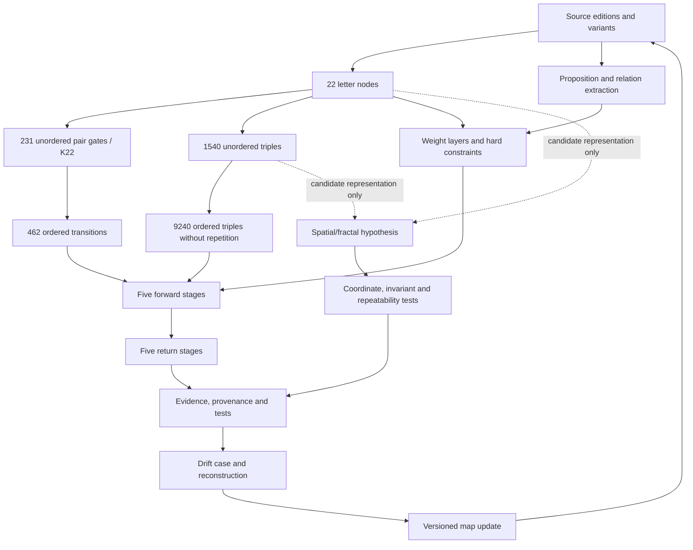

# WANGA-LAB Logic Corpus — Master Map Atlas

**Status:** SPECIFIED / NOT_YET_VERIFIED. The atlas defines a proposed source-to-structure architecture; it does not assert that the full gate runtime or fractal embedding is implemented.

## Ten macro maps × ten submap lenses
M01 sources/editions; M02 letter nodes; M03 K22/231 gates; M04 462 ordered transitions; M05 triple combinatorics; M06 proposition/relations; M07 weight layers/constraints; M08 5+5 loop; M09 spatial/fractal hypotheses; M10 forensic drift/solution packages.

Every macro map has the ten lenses: source/edition, formal schema, relations/operations, bounds/invariants, source example, counterexample/ambiguity, cross-scale transition, visualization, test/measurement, reconstruction/re-entry. The 100 individual submap definitions are in the page registry.

## Exact count distinctions
- C(22,2)=231 unordered pairs.
- 22×21=462 ordered pairs.
- C(22,3)=1540 unordered sets of three different letters.
- 22×21×20=9240 ordered triples without repetition.
- 22³=10648 ordered triples if repetition is permitted.

**1,540 is not the number of ordered chains.** It is the number of unordered three-letter sets; each can appear in six orders, for 9,240 distinct ordered triples without repetition.

## Data and registry files
- [Registry index](../research/data/LOGIC_CORPUS_1000_PAGE_BLUEPRINT_V1.json)
- [Letter-node page definitions](../research/data/LOGIC_CORPUS_PAGES_LETTER_V1.json)
- [Gate page definitions](../research/data/LOGIC_CORPUS_PAGES_GATES_V1.json)
- [Directed-transition page definitions](../research/data/LOGIC_CORPUS_PAGES_DIRECTED_V1.json)
- [Submap page definitions](../research/data/LOGIC_CORPUS_PAGES_SUBMAPS_V1.json)
- [Validation page definitions](../research/data/LOGIC_CORPUS_PAGES_TESTS_V1.json)
- [Formalization page definitions](../research/data/LOGIC_CORPUS_PAGES_FORMAL_V1.json)
- [231 gate / 462 transition data](../research/data/LETTER_GATE_MAP_231_V1.json)
- [1,540 unordered triples](../research/data/LETTER_TRIPLE_MAP_1540_V1.json)
- [Mathematical integrity register](./LOGIC_231_MATHEMATICAL_INTEGRITY_REGISTER_V1.md)

## Sources and open obligations
The [Sefaria text](https://www.sefaria.org/Sefer_Yetzirah.2.1?lang=en&with=Translations) shows the 231-gate reading. Scholarship discusses 221/231 textual and calculation variants: [Ben-Shachar (2025)](https://cris.iucc.ac.il/en/publications/%D7%A0%D7%9E%D7%A6%D7%90%D7%95-%D7%99%D7%95%D7%A6%D7%90%D7%95%D7%AA-%D7%91%D7%A8%D7%9C%D7%90-%D7%A9%D7%A2%D7%A8%D7%99%D7%9D-%D7%A0%D7%90-%D7%9E%D7%90%D7%AA%D7%99%D7%9D-%D7%A2%D7%A9%D7%A8%D7%99%D7%9D-%D7%95%D7%90%D7%97%D7%93-%D7%A2%D7%9C-%D7%A9%D7%99%D7%98%D7%95%D7%AA-%D7%97%D7%99%D7%A9%D7%95%D7%91-%D7%9E%D7%A1%D7%A4%D7%A8-%D7%94/) and [Bar-Asher (2023)](https://cris.huji.ac.il/en/publications/the-earliest-version-of-sefer-yeirah-text-format-structure-and-ge/).

The four original mathematical-logical weight-layer formulas must be recovered. A 10-DOF/ Lie-algebra / E8 / Tonnetz / fractal embedding requires explicit mapping, operations, invariants and tests before it can be treated as established.

## Interactive published atlas

- [Open the live interactive explorer](https://headless-jhbcjnxnldu-beywolf5-1408.wix-site-host.com/logic-corpus-atlas.html).
- Search and filter the 1,000 page definitions; explore K22/231 gate edges, 462 directed transitions and the 1,540 unordered triple sets.
- Live browser QA passed on 2026-10-12 for data loading, mode switching and search of `GATE-001`.
