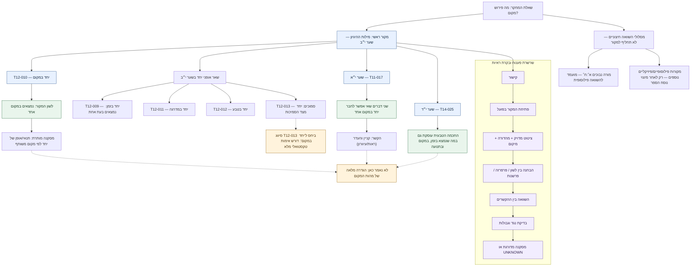

# מפת מקורות לפענוח מדויק של „מקום” — V1

**סטטוס:** מפת חקירה ראשונית; אינה הגדרה סופית של מקום.  
**כלל יסוד:** לא מניחים שמקום הוא מושג לוגי רק מפני שהוא נזכר בספר העוסק בהיגיון.

## תרשים

## ממצאים ישירים מתוך מאגר היחידות

| מזהה | שער | לשון מקור / תמצית מדויקת | מה מותר להסיק | מה אסור להסיק |
|---|---|---|---|---|
| T12-010 | י״ב | „ונאמר שהם יחד במקום, כאשר יהיו נמצאים במקום אחד” | הספר מתאר אופן של „יחד” באמצעות הימצאות במקום אחד | אין כאן הגדרה מלאה של מהות המקום |
| T12-009 | י״ב | „יחד בזמן” כשנמצאים בעת אחת | יחס של בו-זמניות | אין לזהות זמן עם מקום |
| T12-011 | י״ב | „יחד במדרגה” | יחס מדרגי מסוים | אין לצמצם מדרגה למיקום מרחבי |
| T12-012 | י״ב | „יחד בטבע” | יחס טבעי בין דברים המספיקים במציאותם ואינם סיבה זה לזה | אין להסיק שזהו אותו יחס כמו יחד במקום |
| T12-013 | י״ב | סמוכים נאמר עליהם שהם יחד מצד הסמיכות | סמיכות קשורה לדיון על יחד | מעמדו המדויק ביחס לארבעת אופני היחד שבמפתח דורש בדיקה |
| T11-017 | י״א | שני דברים שאי אפשר לחבר יחד במקום אחד; דוגמת ראות ועיוורון | „במקום אחד” מופיע בהקשר של קניין והעדר | אין להעביר את המשפט הזה כהגדרת מקום |
| T14-025 | י״ד | הטבעית עוסקת במה שנמצא בזמן, במקום ובתנועה | מקום מופיע כאחד מתחומי העיון של החכמה הטבעית | אין כאן הגדרה של מקום |

## קישורים שנאספו

1. [מפתח 14 השערים ב-Notion](https://app.notion.com/p/42449ee8e17d814e8ea1ee065ddd6015)
2. [מקור הטקסט בוויקיטקסט — מילות ההיגיון](https://he.wikisource.org/wiki/מילות_ההגיון)
3. [מאגר WANGA-LAB — מילות ההיגיון, שער י״ב](https://github.com/Quadruple-Multilevel-projection-project/WANGA-LAB/blob/main/milaot-hahigayon/sentences/%D7%A9%D7%A2%D7%A8-%D7%99%D7%91.md) — קישור הרשום במאגר המקורות; פתיחת הקובץ לא אומתה בהצלחה בסבב הנוכחי.
4. [מפת FOL / סדר שני / לוגיקה פרקטלית ועקיבות](https://github.com/Quadruple-Multilevel-projection-project/WANGA-LAB/blob/main/docs/FOL_SECOND_ORDER_FRACTAL_WANGA_TRACEABILITY_MAP_HE_V1.md)
5. [תצפית המחקר הראשי: מקום / MAKOM](https://github.com/Quadruple-Multilevel-projection-project/WANGA-LAB/blob/main/research/PRIMARY_PROJECT_MAKOM_SYMBOLIC_LANGUAGE_OBSERVATION.md)
6. [אינדקס הדיאגרמות של WANGA-LAB](https://github.com/Quadruple-Multilevel-projection-project/WANGA-LAB/blob/main/docs/DIAGRAM_INDEX.md)
7. [GitDiagram — מפת ארכיטקטורת המאגר](https://gitdiagram.com/quadruple-multilevel-projection-project/wanga-lab) — כלי ניווט ארכיטקטוני; אינו מקור סמנטי למושג „מקום”.
8. [Airtable — Logic Analytics Registry](https://airtable.com/applIOEpzJQxnbvs7) — יחידות מקור, קשרים ומפות; יחידות T11/T12/T14 נשמרות כמזהים נפרדים.
9. [Recall — Second Brain](https://www.recall.wiki/) — בחיפוש הנוכחי לא נמצאו מקורות שמורים רלוונטיים לפירוש „מקום”; נמצא רק חומר הדרכה כללי על Recall.

## סדר הפענוח המחייב

1. לפתוח את המקור הראשי בפועל ולשמור מהדורה, עמוד/מיקום, ציטוט והקשר.
2. להשלים את כל יחידות שער י״ב, ובפרט לברר את היחס בין T12-010 („יחד במקום”) לבין T12-013 (סמיכות).
3. לבדוק את ההופעות בשער י״א ובשער י״ד בלי למזג את תפקידן.
4. רק לאחר מכן להשוות למקורות פילוסופיים נוספים, ובכלל זה מורה נבוכים א׳:ח׳, תוך תיוגם כמקורות השוואה ולא כתחליף ללשון הספר.
5. לכל טענה לרשום: ציטוט מקור, פרפרזה, פרשנות, השערה, ראיית נגד וסטטוס אימות.
6. אם המקור אינו מגדיר — התוצאה נשארת **NOT_ESTABLISHED**, ולא ממלאים את החסר בהגדרה חיצונית.

## סטטוס

- T12-010, T11-017, T14-025: קיימות יחידות מצוטטות במאגר Airtable; סטטוס היחידות שם מסומן VERIFIED, אך יש לאמת את מיקום הציטוטים מול עותק המקור לפני מסקנה כוללת.
- מיצוי מלא של כל המקורות המקושרים: בתהליך.
- הגדרה מהותית של „מקום”: **טרם הוכחה מתוך מילות ההיגיון**.
- מפת הקשרים: ניווט מחקרי, לא היסק לוגי.
