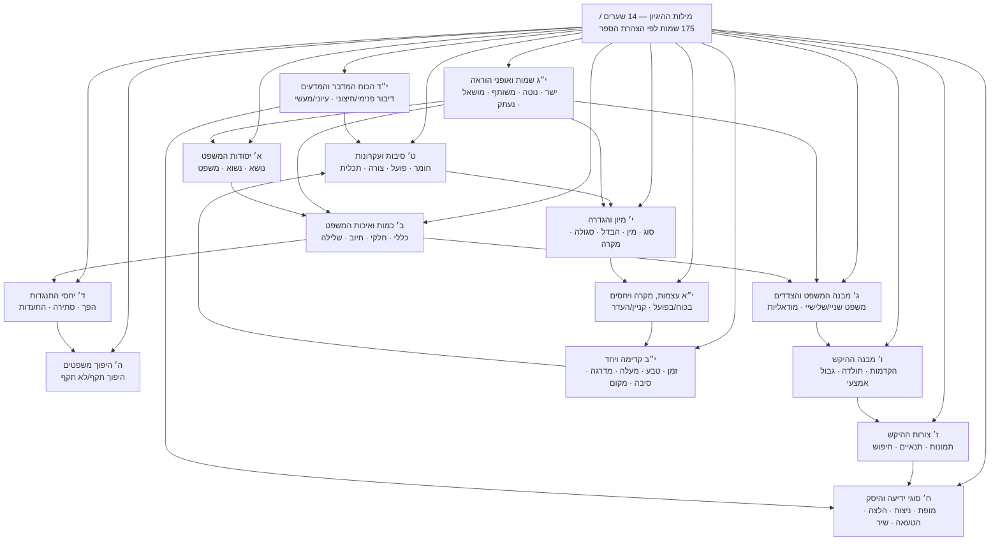

# מפת נושאי הספר — מילות ההיגיון

מפה זו היא תרשים ניווט נושאי המבוסס על שערי תרגום אבן תבון בקובץ הסרוק שהועלה לפרויקט. שמות הצמתים הם תוויות מיפוי, לא בהכרח כותרות מקוריות. קשרים בין שערים מסמנים זיקות לחקירה, לא היסק מוכח.

## קישורים

- [מפתח 14 השערים והנושאים](MILOT_HA_HIGAYON_14_GATE_SUBJECT_INDEX_HE_V1.md)
- [קובץ Mermaid מקור](../diagrams/MILOT_HA_HIGAYON_14_GATE_SUBJECT_MAP_V1.mmd)
- [GitDiagram — ארכיטקטורת המאגר](https://gitdiagram.com/quadruple-multilevel-projection-project/wanga-lab)

## גבול ראייתי

הספר מציין בסופו י״ד שערים וקע״ה שמות. התרשים מציג את מבנה 14 השערים ואת הקשרים הנושאיים שנגזרו מן הטקסט; הוא אינו טוען שכל 175 השמות כבר חולצו, אומתו או סווגו.
