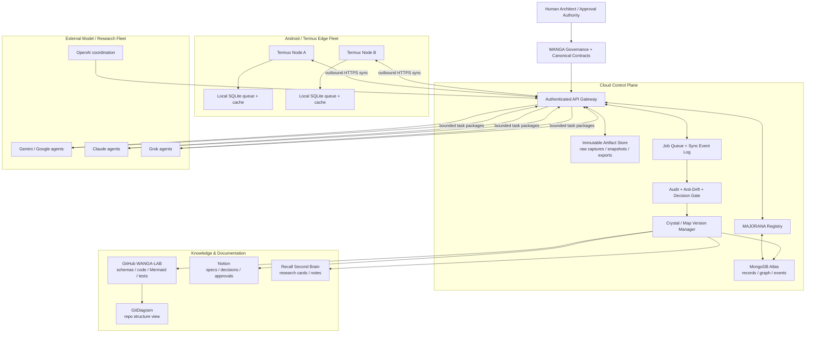

# MAJORANA Hyperdimensional Atlas & Edge Distribution Architecture v0.1

**Status:** PROPOSED ARCHITECTURE — not yet deployed or experimentally validated
**Canonical project name:** MAJORANA (older working labels: Miorna-1 / Miorna; do not silently rename historical records)
**Repository:** WANGA-LAB
**Branch:** feat/majorana-hyperdimensional-edge-distribution-v0-1

## 1. Purpose
Define one traceable architecture for recording, mapping, versioning, validating, exporting and distributing a single MAJORANA crystal instance across cloud services, AI platforms, GitHub, Notion, Recall, MongoDB Atlas and Android Termux edge nodes.

The system preserves separate identities for physical/geometric coordinates (3D XYZ), operational/state coordinates (4D XYZW), proposed high-dimensional topology (including the 126D Kruger-space model), 15,625 lattice points, 231 gates, 230 space groups, and semantic relations. These are linked systems, not interchangeable counts or coordinate frames.

## 2. Canonical model and unresolved items

| Item | Current treatment |
|---|---|
| MAJORANA instance | Stable `crystal_id`; every map is scoped to it |
| Lattice | 15,625 discrete point IDs |
| Hyperdimensional model | 126D Kruger-space is proposed; basis, units and transforms must be specified before numerical coordinates are accepted |
| 3D geometry | XYZ frame for spatial visualization; does not replace high-dimensional representation |
| 4D operational state | XYZW; W remains operational/state coordinate until formally defined |
| 231 gates | Separate canonical gate registry |
| 230 space groups | Separate canonical space-group registry |
| 21×11 | 231 cells; cell-to-gate mapping must be explicit and versioned |
| 81×81 | Historical/candidate projection only; not equated with 15,625 points or 126D until reconciled |
| TANTA | Four ordered layers: Taamim → Nekudot → Tagin → Otiyot; convergence is output, not fifth TANTA layer |
| KRAKEN 36 | Outer 18 + Inner 18 role groups; no inference of physical hardware or quantum execution |

No missing coordinate, gate index, mapping, weight or semantic relation may be fabricated. Unknown fields remain null/UNRESOLVED.

## 3. Multi-space coordinate contract
Every mapped object carries `coordinate_space_id`, `coordinate_space_type`, `coordinate_frame_version`, `basis_ref`, `transform_ref`, `coordinates`, `projection_ref`, `projection_loss` (NONE/LOSSY/UNKNOWN) and `invertible` (true/false/unknown).

Coordinate-space types: PHYSICAL_3D | OPERATIONAL_4D | HYPER_126D | LATTICE_15625 | TOPOLOGY_231 | SPACE_GROUP_230 | SEMANTIC_GRAPH.

A 2D/3D rendering is a projection of the hyperdimensional model, not the complete object. Mermaid is for component topology, dependencies and process flow; it is not a native 3D/126D geometry renderer.

## 4. Record identity and provenance
Every durable record includes `record_id`, `crystal_id`, `map_id`, applicable `node_id`/`edge_id`, `schema_version`, `crystal_version`, `map_version`, source URI and exact locator, retrieval time, SHA-256 of original bytes where available, parent/superseded record IDs, event ID, evidence status, decision status, creator, reviewer and approval receipt.

Evidence status: VERIFIED | ASSESSED | HYPOTHESIS | NOT_YET_VERIFIED. Decision status: CANDIDATE | PASS_FOR_REVIEW | LOCK | HUMAN_REVIEW | ABSTAIN | BLOCKED.

Original source payloads are immutable. Extraction, normalization, semantic interpretation and diagram rendering are separate derived artifacts. Each cycle creates a delta/snapshot, never overwrites historical evidence.

## 5. Data ownership across systems

| System | Authoritative responsibility | Boundary |
|---|---|---|
| GitHub / WANGA-LAB | Canonical code, JSON schemas, contracts, Mermaid sources, tests, releases, PR history | Code artifacts do not prove runtime |
| MongoDB Atlas | Operational registry: crystal instances, maps, nodes, edges, events, device registry, sync cursors, audit receipts | Not the sole archive for large source files |
| Object/file storage | Immutable source captures, exports, binary map packages and snapshots | No unversioned mutable state |
| Notion | Architecture decisions, specifications, human approvals, handoffs, unresolved questions | Not the canonical code/schema registry |
| Recall: Second Brain | Searchable research memory, saved source cards, notes and discovery | Not decision authority or canonical writer |
| GitDiagram | Read-only repository architecture view derived from code | Not a semantic crystal map or proof of runtime |
| MCP Precheck | Registry-based check before adding/configuring an external MCP server | Not a source-code security audit |
| Termux edge nodes | Local capture, bounded extraction, validation client, offline queue, sync agent | Not canonical authority or public command server |
| External AI platforms | Independent discovery, extraction, critique and candidate mapping | No direct LOCK or unreviewed core writes |

## 6. Distribution topology

## 7. Hyperdimensional map package
One MAJORANA crystal can have multiple synchronized map views. Each view references the same crystal and source records but has its own map identity and projection definition.

Required map types: MASTER_TOPOLOGY; LATTICE_MAP_15625; HYPER_MAP_126D; PHYSICAL_MAP_3D; OPERATIONAL_MAP_4D; TANTA_MAP; GATE_MAP_231; SPACE_GROUP_MAP_230; KRAKEN36_MAP; SEMANTIC_RELATION_MAP; PROJECTION_LINEAGE_MAP.

A map manifest specifies `map_id`, `crystal_id`, `map_type`, `source_snapshot_id`, `coordinate_space_id`, `projection_id`, `schema_version`, `renderer`, `loss_profile`, `created_at`, `content_hash`, `validation_receipt` and `status`.

## 8. Termux edge-node contract
Termux is a first-class edge execution tier, not a remote root shell. Each Android device registers independently with `device_id`, `node_role`, platform, Termux version, Android API level, capabilities, worker versions, public-key ID, last-seen time, sync cursor and health status.

Rules:
- Outbound HTTPS only by default; do not expose an unauthenticated Termux HTTP/MCP listener to the public internet.
- Device authentication uses revocable identity; credentials stay local and never enter GitHub, Notion, Recall or logs.
- Cloud sends signed, bounded task manifests; edge validates signature, expiry, allowlist, schema and idempotency key.
- Local SQLite queue supports offline capture and retry; uploads are idempotent and content-hash deduplicated.
- Edge returns raw capture, provenance, worker version and execution receipt. It cannot issue LOCK.
- Human approval is required before canonical schema, map, gate or crystal-state changes.
- Android may restrict background execution and battery optimization may terminate work. Missed heartbeats are recorded; schedules are best-effort.
- Start with pull-based polling and explicitly started worker. Add Termux:Tasker or Termux:Boot only after device-level test and approval.

## 9. Sync protocol
1. REGISTER — device obtains `device_id` and scoped credentials.
2. PULL — fetch signed task manifest after `last_sync_cursor`.
3. VERIFY — signature, expiry, allowlist, schema version and idempotency key.
4. EXECUTE — bounded task in local workspace; no arbitrary shell from cloud.
5. CAPTURE — preserve original bytes and exact source locator.
6. PACKAGE — emit JSONL records, artifact references and SHA-256 hashes.
7. PUSH — upload with idempotency key; retry safely after network failure.
8. ACK — server stores receipt and advances cursor only after durable acceptance.
9. RECONCILE — duplicate, stale schema or conflicting snapshot is quarantined; never silently overwritten.
10. REVIEW — audit and human decision; only then create validated delta.

## 10. Export and handoff formats
- `manifest.json` — identity, versions, coordinate frames, lineage and checksums.
- `records.jsonl` — streamable nodes, edges, gate and evidence records.
- `schema.json` — JSON Schema for record validation.
- `diagrams/*.mmd` — Mermaid flowcharts and dependency maps.
- `maps/*.glb` or `maps/*.gltf` — optional 3D scene exports when a real geometry renderer exists.
- `arrays/*.npz` or Parquet — optional dense numerical arrays; do not place huge arrays in one MongoDB document.
- `evidence/manifest.sha256` — artifact checksum inventory.
- `README.md` — human handoff, status and replay instructions.

Every export is reproducible from a source snapshot and projection definition. Mermaid describes system structure and process, not full 126D geometry.

## 11. Agent/platform handoff
All platforms receive the same task envelope: `task_id`, `crystal_id`, `map_id`, `scope`, `allowed_operations`, `input_refs`, `schema_version`, `deadline`, `output_contract`, `provenance_required`, `decision_authority=NONE`.

Google/Gemini: discovery, browser capture and extraction. Claude: independent structural critique and counterexample search. Grok: alternative hypothesis and contradiction search. OpenAI coordinator: task decomposition, normalization, comparison and report assembly. All model outputs remain CANDIDATE until evidence audit.

Before connecting a new MCP server, run MCP Precheck on the exact server/package. Report identity, grade, capabilities, authentication, freshness, changes and suggested action. Unknown registry record is UNKNOWN, not safe or dangerous. Precheck is not a source-code audit.

## 12. Multi-diagram registry and CI
Every diagram declares stable `diagram_id`, `map_id`, `crystal_id`, owner subsystem, source files, input schema, output artifacts, dependencies, contract and renderer versions, and tests for unresolved nodes, broken references, count consistency, directionality and stale snapshots.

CI validates JSON schemas and references; checks counts without conflating 15,625 / 126 / 231 / 230 / 21×11 / 81×81; renders Mermaid; detects dangling IDs; compares diagram diffs; produces release artifacts and checksums; and requires human approval for canonical release.

GitDiagram inspects software repository architecture. It is not the renderer for crystal hyperdimensional geometry.

## 13. Rollout sequence
**P0 — Contract freeze:** define IDs, coordinate-frame registry, 126D basis status, 81×81 discrepancy and map manifest.
**P1 — Canonical repository:** add schemas, sample records, Mermaid diagrams and CI validation to WANGA-LAB.
**P2 — Cloud registry:** connect MongoDB Atlas only after confirming cluster, database, workload and access pattern; apply schema validation and versioning.
**P3 — Knowledge links:** link GitHub artifacts to Notion decisions and Recall research cards using stable IDs and URLs.
**P4 — One Termux node pilot:** register one device, capture one source, queue offline, sync, replay and verify receipt. Then add the second device independently.
**P5 — Multi-platform adapters:** enable model providers one at a time after MCP Precheck and bounded tests.
**P6 — Hyperdimensional visualization:** after basis and transforms are specified, implement numerical projection and optional 3D scene rendering.

## 14. Current implementation status
- WANGA-LAB repository exists and is accessible to the connected GitHub identity.
- GitDiagram has a repository-level architecture snapshot (2026-11-24); it maps code organization, not crystal geometry.
- Notion contains WANGA multi-platform orchestration and diagram-intelligence specifications.
- Recall is available as a research-memory connector; the current search did not establish a saved Majorana/Termux architecture record.
- MongoDB Atlas connector is available, but no database/cluster/schema connection was verified in this task.
- Termux device connectivity, local worker, sync endpoint and device identities are NOT_YET_VERIFIED.
- No 126D basis, 81×81 reconciliation, physical photonic implementation or hardware execution is verified by this document.

**Release rule:** no proposal becomes a deployed capability without a test receipt, read-back and explicit status transition.