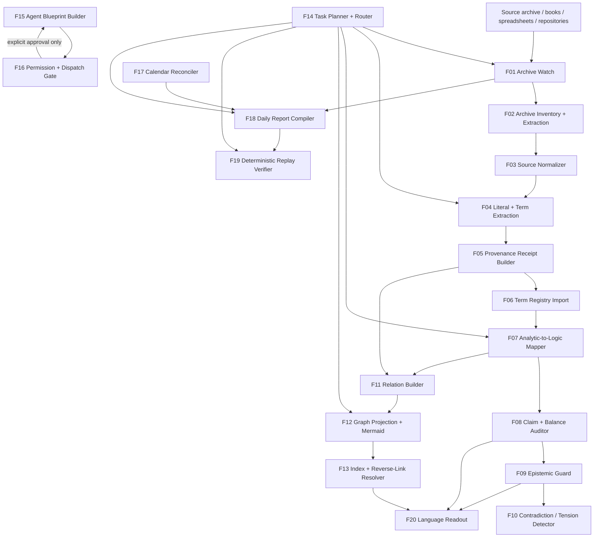
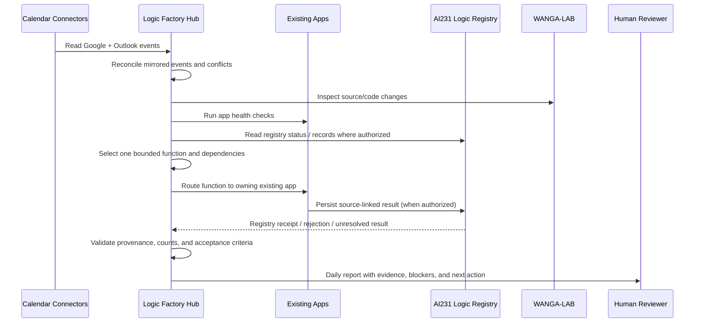
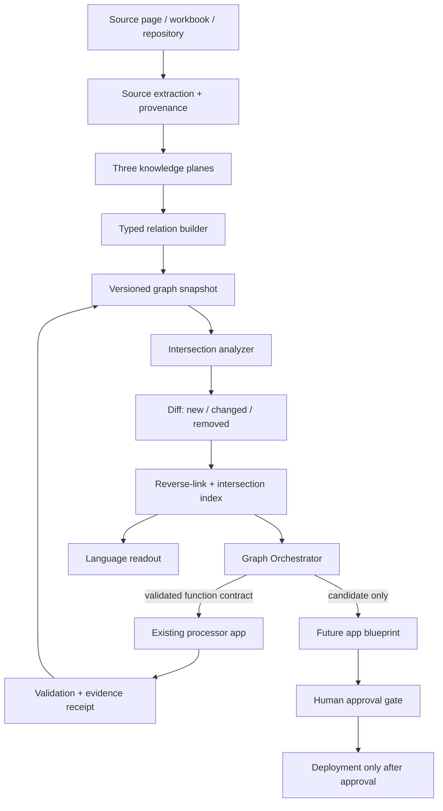

# WANGA / Logic Factory — Daily Processor Operating Map

**Document class:** operating architecture + daily runbook  
**Created:** 2026-11-24  
**Canonical application hub:** [Logic Factory Hub](https://logic-factory-hub-9jj4jw.v2.appdeploy.ai/)  
**Canonical code/evidence repository:** [WANGA-LAB](https://github.com/Quadruple-Multilevel-projection-project/WANGA-LAB)

> This document decomposes the existing system into processor functions. It does not propose duplicate applications. A processor family is a responsibility boundary; a function is an executable unit; an app is a deployment boundary. These are different levels.

## 1. System diagram

## 2. Existing application deployment map

| Existing application / service | Processor responsibilities routed through it | Current evidence |
|---|---|---|
| [Logic Factory Hub](https://logic-factory-hub-9jj4jw.v2.appdeploy.ai/) | Orchestration, task planning, app health checks, gate control, Excel relay, diagram relay, action receipts | Deployed app; backend routes inspected |
| [Logic Analytics Orchestrator](https://milot-hahigayon-logic-analytics-orchestrator-5hz495.v2.appdeploy.ai/) | Source analytics and candidate logical mapping | Deployed app; API-to-API integration not verified |
| [מפת הקשרים — בדיקת טענות ואיזונים](https://app-mcuqrn.v2.appdeploy.ai/) | Claims, assumptions, evidence, alternatives, contradiction candidates | Deployed app; runtime integration not verified |
| [שער הידיעה והוודאות](https://app-asqobu.v2.appdeploy.ai/) | Epistemic classification and uncertainty guard | Deployed app; runtime integration not verified |
| [AI231 Logic Registry](https://ai231-logic-registry-1y5kvl.v2.appdeploy.ai/) | Source/term/map registry, workbook cells, relation records | Deployed app; writes require authenticated Registry owner and configured secret |
| [AI231 Agent Foundry](https://ai231-agent-foundry-35gumn.v2.appdeploy.ai/) | Agent blueprints and bounded dispatch | Deployed app; end-to-end runtime/permission verification remains separate |
| [Logical Configuration Orchestrator](https://logical-configuration-orchestrator-5fvr64.v2.appdeploy.ai/) | Configuration contracts, prerequisites and acceptance gates | Deployed app; direct relay from Hub not verified |

**Rule:** do not create a second app for a processor family. Add a function/module to the existing app that owns the responsibility. Add a separate deployment only when an independently deployable runtime boundary is justified and approved.

## 3. Function-level contracts

| ID | Function | Owner | Input → output | State |
|---|---|---|---|---|
| F01 | Archive Watch | Hub / source connector | Drive metadata → changed/new archive event | BLOCKED: only an old ZIP was found |
| F02 | Archive Inventory + Extraction | Hub / ingestion | Readable ZIP bytes → complete member manifest + extracted files | BLOCKED: raw bytes not readable here |
| F03 | Source Normalizer | Logic Analytics | Original file + locator → normalized source units | SPECIFIED |
| F04 | Literal + Term Extraction | Logic Analytics | Source units → exact terms/quotations with locators | EXISTING_CODE_PARTIAL |
| F05 | Provenance Receipt Builder | Hub + Registry | Source/version/transformation → receipt + SHA-256 digest | EXISTING_CODE_PARTIAL |
| F06 | Term Registry Import | Logic Registry | Source-linked terms/cells → registry records | EXISTING_CODE_PARTIAL |
| F07 | Analytic-to-Logic Mapper | Logic Analytics | Invariant + candidate logical tool → typed mapping candidate | SPECIFIED |
| F08 | Claim + Balance Auditor | Claims app | Claim + premises + evidence → audit + alternatives | EXISTING_CODE_PARTIAL |
| F09 | Epistemic Guard | Epistemic app | Claim + evidence type → epistemic status | EXISTING_CODE_PARTIAL |
| F10 | Contradiction / Tension Detector | Claims app | Competing statements → conflict set with both sides preserved | SPECIFIED |
| F11 | Relation Builder | Logic Registry | Verified nodes + typed relation → edge candidates | EXISTING_CODE_PARTIAL |
| F12 | Graph Projection + Mermaid | Hub + Registry | Nodes/edges → Mermaid graph | EXISTING_CODE_PARTIAL |
| F13 | Index + Reverse-Link Resolver | Logic Registry | Stable IDs → forward/reverse paths + missing links | EXISTING_CODE_PARTIAL |
| F14 | Task Planner + Router | Hub | Objective + function contracts → ordered PROPOSED job | EXISTING_CODE_PARTIAL |
| F15 | Agent Blueprint Builder | Agent Foundry | Approved task + capability manifest → blueprint | EXISTING_CODE_PARTIAL |
| F16 | Permission + Dispatch Gate | Hub | Diagram approval + endpoint + user approval → BLOCKED/READY | EXISTING_CODE_PARTIAL |
| F17 | Calendar Reconciler | Google + Outlook connectors | Calendar events → deduplicated schedule + conflicts | CONNECTORS USED; no app-native bridge verified |
| F18 | Daily Report Compiler | Hub | Registry + app health + jobs + archive watch + calendar state → dated report | SPECIFIED |
| F19 | Deterministic Replay Verifier | Hub + WANGA-LAB | Receipt + inputs/version → replay comparison | SPECIFIED |
| F20 | Language Readout | Logic Analytics | Verified graph + audit + provenance → explanation | SPECIFIED |

The detailed contracts, dependencies and acceptance criteria are stored in the Airtable **Processor Functions** table. Family-level ownership is in **Processor Registry**.

## 4. Daily work cycle (Asia/Jerusalem)

| Time | Work block | Required result |
|---|---|---|
| 09:00–10:00, Monday–Friday | Daily processor build block | Inspect source/archive changes, choose one bounded function, update evidence and next action |
| 10:00–11:30, scheduled source-inventory day | Source inventory and evidence map | Inventory source texts, locations, versions and missing material |
| 10:00–11:30, scheduled registry day | Registry and data model | Stable IDs, node/edge types, provenance fields and reconciliation |
| End of day, target 19:00 | Daily report | Completed, blocked, changed, app status, calendar conflicts, archive status and next task |

A recurring 09:00–10:00 Monday–Friday work block was created in both Google Calendar and Outlook Calendar. Existing mirrored source-inventory and registry/data-model blocks were preserved.

**Daily report scheduler:** not yet enabled. The ChatGPT automation service currently reports 3/3 active scheduled tasks, so a fourth daily automation could not be created. Do not silently replace or disable an existing task. An app-native daily report cron may be implemented in the existing Hub, subject to source-access and delivery configuration.

## 5. Daily execution sequence

## 6. Operating rules

1. **No duplicate apps:** functions are assigned to existing app owners. Do not create an app merely because a new processor family was named.
2. **No invented wiring:** an app being deployed does not prove API-to-API integration. Verify each connection with a real read/write round trip.
3. **No source mutation:** originals remain immutable. Extract to a separate destination and retain source IDs and locators.
4. **Preserve disagreement:** keep both claims and mark the relationship as contradiction, tension, ambiguity or unresolved data gap; do not force consensus.
5. **Evidence states are distinct:** `SPECIFIED ≠ BUILT ≠ TESTED ≠ VERIFIED`.
6. **No premature agent dispatch:** the Hub's current gate requires introduction-diagram evidence, Foundry endpoint reachability and an explicit user action.
7. **No weights without evidence:** do not create weights or numeric parameters to fill an empty field.
8. **Daily report honesty:** report missing permissions, inaccessible files and failed connectors; never claim a ZIP was extracted if its bytes were not read.
9. **Calendar deduplication:** Google and Outlook may contain mirrored copies of the same event. Match by iCal UID when available, otherwise by title + normalized start/end; do not double-count.
10. **Archive watch:** record exact OneDrive item ID, file name, modified time, size and fingerprint; compare on every run.

## 7. ZIP currently found — not confirmed as today's upload

The OneDrive search returned one ZIP:

- Name: `Management documents .. מסמכי הנהלה.zip`
- OneDrive item ID: `D080FA7DBD50A316!114`
- Created/updated: `2025-03-05T09:32:09Z`
- Size: `2,976 bytes`
- MIME: `application/zip`

The connector returned no readable content and no raw bytes in this environment. Therefore **no archive member has been extracted or inventoried**. This file is not evidence of a ZIP uploaded today. The current-day ZIP must be attached in the chat or placed in an accessible OneDrive/SharePoint location before extraction can be completed.

## 8. Immediate implementation order

1. Obtain the actual current ZIP and extract its complete contents.
2. Reconcile extracted artifacts with the existing 15 deployed apps and source repositories.
3. Add function modules to the existing Hub / Logic Analytics / Claims / Epistemic / Registry / Foundry apps, not new duplicate apps.
4. Implement the daily report inside the existing Hub, with an auditable run ledger and a visible report history.
5. Add calendar-native OAuth bridging only if the app itself must read calendars without the ChatGPT connector.
6. Test each inter-app call, write receipt, permission gate and report delivery independently.
7. Mark each function BUILT, TESTED or VERIFIED only after the corresponding evidence exists.

---
**Status at creation:** architecture/function contracts recorded; calendar work block created in Google and Outlook; daily automation creation blocked by the 3-active-task limit; ZIP extraction blocked because the found file is old and its bytes were not accessible.

## 9. Graph / Intersection Orchestrator — extracted model and boundaries

### 9.1 What the current model files actually say

The three files under `neural_wikipedia/` currently define different responsibilities:

| File | Declared role | Declared contents | Current boundary |
|---|---|---|---|
| `index_model.json` | Index | Channels: up_down, width, depth; temporal: current, previous, next; 231 gates as 3D directional parameters + planetary coordinates | Index representation; it does not yet define graph intersections or execution routing |
| `encyclopedia_model.json` | Encyclopedia (Logic Wikipedia) | Locked logic rules; day axis = Talmud logic; night axis = Sefer HaHiggayon language logic | Logic-rule store; no claim that it is the graph runtime |
| `language_model.json` | Language Model | Same three spatial channels and three temporal positions; formatted output only | Readout/output representation, not the internal graph or reasoning engine |

The current model files do **not** yet specify a complete map-intersection schema, a map-version ledger, a semantic-network coordinate contract, or an execution-routing contract. These remain implementation requirements, not verified capabilities.

### 9.2 Three linked knowledge planes

The target structure is three linked but non-collapsed Wikipedia planes:

1. **Logic of structure** — rules, logical types, constraints, permitted transitions, contradiction and validation status.
2. **Language** — letters, letter combinations, language units, terms and their structural relations.
3. **Sentences and words** — source text, exact quotations, sentence decomposition, word-level units, claims, premises and reconstruction paths.

A single source page can project into all three planes, but each extracted object retains its own ID, source locator, version and status. A relation between planes must be typed and evidenced; similarity alone is not a relation.

### 9.3 Graph is both map and orchestration surface — with a separate execution contract

The graph has two distinct responsibilities:

- **Representation:** nodes, typed edges, source lineage, version history, index keys and (when defined) coordinate fields.
- **Orchestration:** selecting the next processor/function from an explicit transition contract.

A visual edge alone must not trigger an action. For an edge to route work, it must carry at least: `from_id`, `to_id`, `relation_type`, `processor_id`, `function_id`, `preconditions`, `required_inputs`, `expected_output`, `validation_gate`, `permission_scope`, `source_refs`, `version` and `status`.

The current Registry map records contain source record IDs, candidate relation edges and Excel links. The relation types include `supports`, `contradicts`, `refines`, `references` and `unresolved`. Those are evidence/knowledge relations; they are not yet executable routing edges. Therefore the current graph is a source-grounded candidate map, not yet a fully functioning orchestrator.

### 9.4 Graph / Intersection Orchestrator flow

The graph does not create a new app merely because two nodes intersect. It first creates an **intersection record**. A separate blueprint function may propose an app/processor only when the intersection exposes a real missing capability and has a source-backed contract. Deployment remains approval-gated.

### 9.5 Measurement contract

Every run records a timestamp, timezone, source/version fingerprint, run ID, map ID, counts and a diff against the prior snapshot.

| Metric | Measurement rule | What it does not prove |
|---|---|---|
| Map inventory | Count of readable, versioned maps | Completeness of the source corpus |
| Node inventory | Unique stable source/node IDs | Semantic correctness |
| Edge inventory | Unique typed relation keys | Truth of a proposed relation |
| Provenance coverage | Share of nodes/edges with resolvable source locator and exact evidence | Validity of the interpretation |
| Index integrity | Unique IDs, resolvable endpoints, reverse-link consistency | Correctness of the underlying logic |
| Structural intersections | Exact shared record IDs, canonical relation keys or workbook-cell IDs across map pairs | Semantic or geometric intersection |
| Map delta | New, changed and removed map/intersection IDs by fingerprint | Whether a change is an improvement |
| Unresolved load | Count of unresolved relations, missing sources and blocked gates | A failure rate unless a denominator is defined |
| Runtime | Duration, success/failure, last successful snapshot and staleness | Logical accuracy |
| Coordinate integrity | Missing/duplicate coordinate fields and coordinate-schema version | Physical meaning of the coordinates |

Do not publish an “accuracy” percentage without an independently labeled reference set. Do not infer a geometric intersection from coordinate proximity until the coordinate system, units, reference frame and transformation rules are defined.

### 9.6 Proposed cadence and current deployment status

- **Every two hours, Asia/Jerusalem:** deterministic, read-only map snapshot; exact-ID intersections; fingerprint comparison; new/changed/removed map and intersection ledger.
- **19:00, Asia/Jerusalem:** daily consolidation of the two-hour snapshots into the daily intersection map and difference report.
- **No automatic AI enrichment or agent dispatch in the scheduled audit.** Changed items become review candidates; agent work and app deployment require their own permission gates.

The Registry currently has an existing `logic-auto-sync` cron at `*/15 * * * *`. It is a GitHub inbox sync, not the requested map-intersection audit. The Logic Factory Hub has no cron configured. AppDeploy's cron contract supports five-field schedules, including a two-hour interval, but the attempted Registry update was rejected with `FREE_DEPLOYMENT_WINDOW_EXPIRED`; therefore the two-hour audit and 19:00 consolidation are **specified, not active**. No schedule was silently substituted.

### 9.7 Airtable function contracts added

The Processor Functions table now contains three new specification records:

- **F21 — Map Intersection Analyzer** (`SPECIFIED`): exact-ID intersections across maps.
- **F22 — Two-Hour Snapshot and Daily Map Difference Compiler** (`SPECIFIED`): periodic snapshots and daily deltas.
- **F23 — Intersection-to-App Blueprint Gate** (`SPECIFIED`): proposes a future processor/app blueprint only after an intersection is validated; does not deploy it.

These are function specifications, not claims of deployed code.

### 9.8 Agent email infrastructure — current evidence

AgentMail currently exposes three inboxes: `sy-neuro-01`, `sy-neuro-02` and `sy-neuro-03`, all assigned to the Map Link Provenance project. There is no evidence of a provisioned 20,000-agent mail system.

Before provisioning at that scale, the architecture must distinguish between 20,000 independent mailboxes and 20,000 agent identities routed through a shared mail gateway. The latter can preserve per-agent identity, routing and audit without creating 20,000 separate mailbox objects. No bulk mailbox provisioning has been performed.

---
**Status of this addition:** source-derived model extraction and function contracts recorded; two-hour cadence specified but not deployed; semantic/geometric intersection remains unverified; 20,000-agent mail infrastructure not provisioned.
