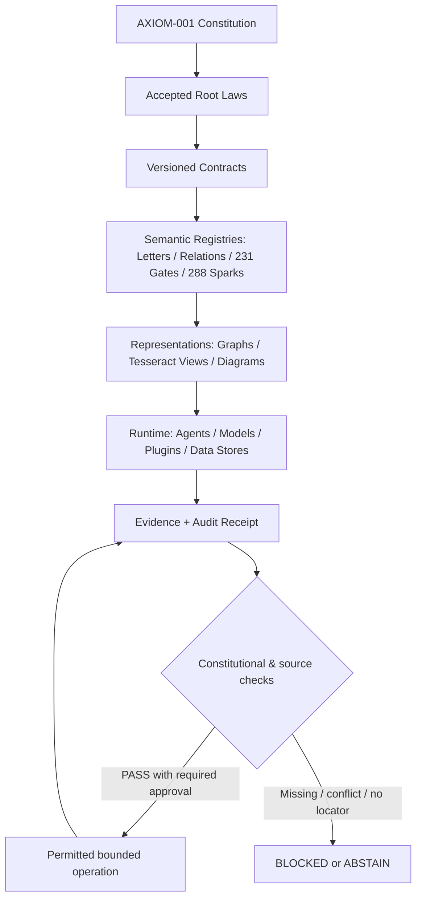
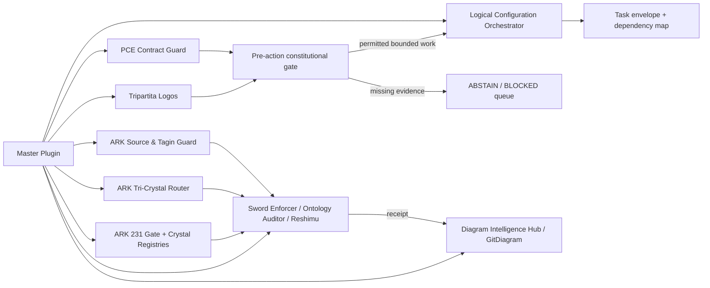
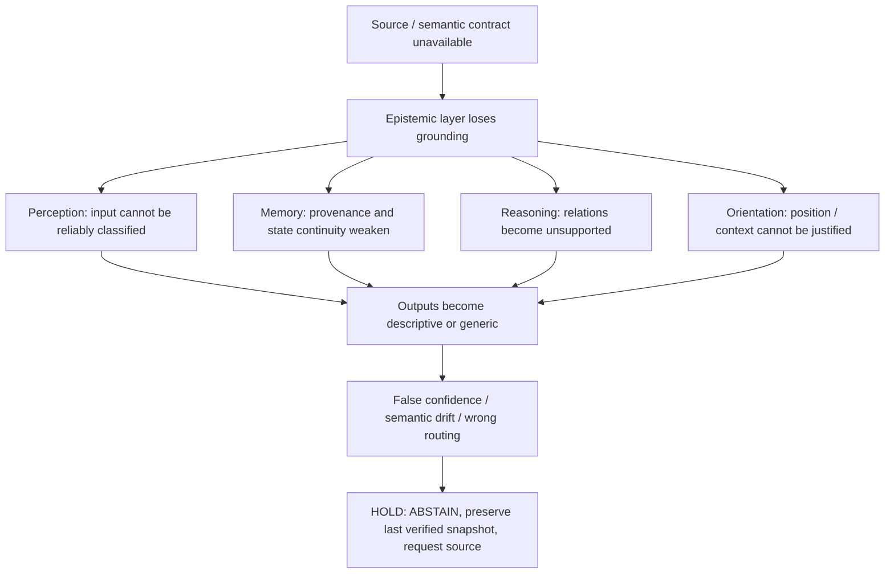

# WANGA / MAJORANA — First Scaffold Audit & Routing Atlas
Version: 0.1.0
Date: 2026-11-26
Status: FIRST-PASS INVENTORY / REVIEW ARTIFACT — not a runtime deployment

## Purpose
Create one navigable first-pass map of the existing project scaffolding. This document indexes what is evidenced in the current project sources, identifies constitutional dependencies and structural gaps, and routes bounded audit tasks to existing specialist modules. It does not create new agents, plugins, credentials, deployments, or semantic mappings.

## Authority and epistemic rules
1. AXIOM-001 is the highest constitutional authority. The full canonical wording and its authoritative source locator are still missing from the reviewed draft; therefore the axiom is recorded as a governing reference but not claimed as sealed or source-verified.
2. Preserve the order SOURCE → LINEAGE → EXTRACTION → RELATIONS → LOGIC → VERIFICATION → CONFIGURATION → WEIGHTS.
3. Preserve the epistemic sequence מוחש → הכרח → מושכל.
4. Keep source fact, interpretation, hypothesis, implementation, and operational status separate.
5. WEIGHTS = NOT_CREATED unless source-grounded, verified, and explicitly authorized.
6. Do not infer physical geometry, coordinates, direction, or crystallographic assignments from a semantic diagram or an index.
7. Diagrams are projections of documented relations, not proof of those relations.
8. Every unresolved constitutional or source dependency blocks core semantic execution. Documentation-only mapping may proceed as review material.

## Evidence inspected in this first pass
- Notion: “WANGA — Multi-Platform Orchestration & Tesseract Configuration (2026-11-26)”, including platform roles, outer/inner tesseract distinction, TaNTaA order, 22 letter streams, 231 gate registry, CFRCEP plan, and MAJORANA/Termux addendum.
- Notion: “WANGA Neural Second Brain — ארבעת המוחות”, “Diagram Intelligence Hub — המוח השני של הדיאגרמות”, and “WANGA / AI231 — מסגרת תיאום, ראיות ושערי אימות” were located by workspace search; full reconciliation of all child blocks and linked records remains pending.
- GitHub: WANGA-LAB review branch `feat/majorana-hyperdimensional-edge-distribution-v0-1`; constitutional directive draft `docs/governance/ROOT_CONSTITUTIONAL_AXIOM_V0_1.md` was fetched and read back.
- Local execution packages: `WANGA_OpenAI_Execution_Package.md` and `WANGA_Google_Continuous_Extraction_Package.md`.
- Local semantic mapping PDF: “מיפוי מקורות ויחסי גרפים סמנטיים - Google Docs.PDF”.
- Local source captures: “תאגי - Google Search - מצב קריאה.pdf” and “תורת המיתרים - Google Search.mht”.
- GitDiagram: a repository code-architecture view was generated/read; it is a code-structure view, not evidence of semantic topology.
- Recall search did not return a matching project architecture card in the first focused pass. This is not evidence that Recall contains no relevant records.

## First-pass scaffold register

| Domain / scaffold | Existing component or artifact | Constitutional relation | First-pass finding | State |
|---|---|---|---|---|
| Constitutional authority | AXIOM-001 draft in WANGA-LAB | Governs all lower layers | Full canonical wording + exact source locator + architect approval are still required | BLOCKED for core execution |
| Contract enforcement | PCE Contract Guard; constitutional gate reference implementation and tests named in draft | Enforces fail-closed preflight | Draft says gate is not connected to live dispatch; tests not reported as run | SPECIFIED / NOT DEPLOYED |
| Master coordination | Master Plugin | Routes by declared specialist capability | Must preserve module boundaries; a registry is not proof of live connections | SPECIFIED |
| Configuration and dependency mapping | Logical Configuration Orchestrator (LCO) | Extracts config, dependencies, QA and receipts | Existing component; reuse it, do not create a duplicate | EXISTING / connection state per target not verified here |
| Semantic boundary and relay | Tripartita Logos — Logic Guard + Relay | Protects ontology/semantics/computation boundary | Must require source-backed handoff and task receipts | EXISTING / runtime state not verified |
| Source integrity | ARK Source & Tagin Guard | Protects provenance of Taamim, Nekudot, Tagin and glyphs | Needs source locator per extracted record | EXISTING / coverage audit pending |
| Gate registry | ARK 231 Gate Registry | Preserves 231 pair identities and lineage | Do not infer gate ID, direction or placement from row/column index alone | REGISTRY AUDIT REQUIRED |
| Tri-crystal routing | ARK Tri-Crystal Router | Routes crystal / 231-gate / 288-spark records | Distinct registries; no implied equivalence or physical entanglement | EXISTING / mapping audit pending |
| Crystal registry | ARK Crystal Registry | Crystallographic identifiers only | 230 space groups and 14 Bravais lattices are distinct sets; no automatic letter mapping | EXISTING / source validation pending |
| Neural cluster | WANGA Neural Cluster Builder | Implements only approved semantic/structural deltas | Proposed model/compute values remain hypotheses until measured | EXISTING / build state not verified |
| Independent audit | Sword Enforcer Audit; ARK-01 Ontology & Logic Auditor; Reshimu/Anti-Drift | Checks evidence, ontology, identity and drift | Audit consensus is not proof; exact evidence locators are mandatory | EXISTING / test receipts pending |
| Diagrams | Diagram Intelligence Hub; GitDiagram | Projects documented code/relations | GitDiagram describes repository structure, not semantic truth | READ-ONLY / mapping coverage pending |
| Operational records | Airtable; MongoDB Atlas | Stores task states and receipts under approved schemas | Not a constitutional authority; connection and schema state must be checked per workspace/project | NOT YET VERIFIED |
| Decisions and handoffs | Notion | Records specifications, decisions, owners and open questions | Central coordination page exists; other pages need reconciliation and stable cross-links | PARTIAL |
| Research memory | Recall Second Brain | Searchable research cards and notes | Memory source, not canonical law or approval authority | SEARCHED / project coverage unresolved |
| Edge execution | Termux | Bounded capture, offline queue, sync receipts | No canonical LOCK or root-law changes from edge nodes | PROPOSED / device pilot not verified |
| External acquisition | Google Search/Scholar/Browser Fleet | Evidence capture only | Google quotas, OAuth, browser endpoints and service identity not verified | NOT RUNNING / BLOCKED pending setup |
| Coordination / synthesis | OpenAI / ChatGPT | Decompose, compare, synthesize, prepare handoffs | Cannot claim control of Google browsers or external models without a verified connector | ACTIVE HERE; external dispatch not evidenced |
| Independent model review | Grok / Claude / Gemini / Microsoft providers | Candidate critique / extraction within boundaries | Provider-specific connections and receipts must be registered separately | NOT VERIFIED |

## First-round priority register
Priority labels are dependency-based, not statistical risk scores. No numeric weights are assigned.

- **P0 — Constitutional source registration:** capture AXIOM-001 verbatim from the architect-designated source, record exact locator/version, and obtain explicit approval. Until then, core semantic execution remains blocked.
- **P0 — Runtime enforcement gap:** connect the constitutional evaluator to every dispatch and canonical state-write boundary; prove fail-closed behavior with executed tests. The current draft explicitly says this is not yet integrated.
- **P1 — Cross-group message continuity:** use one stable task_id, unique message_id, source/destination, axiom reference, source locators, acknowledgement, retry state, and durable receipt. Missing ACK must remain visible; do not assume delivery.
- **P1 — Registry lineage:** reconcile 22 letter streams, 231 gates, 288 sparks, TaNTaA layers, and convergence as distinct records with explicit source lineage and no index-based semantic inference.
- **P1 — Semantic-source audit:** reconcile the semantic mapping PDF's seven-layer framing and its own reported validation categories against exact source passages. Those counts are claims made by that report, not independently re-verified in this first pass.
- **P1 — Package contract conflicts:** the Google package's “infinite-token” and uninterrupted-run language is not an operational guarantee; quotas and budgets must be read from provider configuration. The sample that computes coordinates from gate_id and marks LOCK using a hard-coded stability score is illustrative code, not a valid canonical mapper or proof of a Decision Gate.
- **P2 — Conversation and memory index:** create a cross-reference from each conversation/workstream to canonical artifacts, decisions, open defects and latest receipts. The present pass covers current context, surfaced memory and located Notion pages, not every historical chat.
- **P2 — Diagram synchronization:** update diagrams only after the registry and source lineage are reconciled; diagrams must label VERIFIED / ASSESSMENT / HYPOTHESIS / NOT YET VERIFIED.

## Diagram 1 — Authority and evidence flow


## Diagram 2 — Existing orchestration, no duplicate creation


## Diagram 3 — Epistemic collapse / failure propagation model
This is a failure-mode model for testing, not a claim that a live system has already suffered this event.


## Diagram 4 — Group handoff and acknowledgement
```mermaid
sequenceDiagram
  participant H as Human Architect
  participant M as Master / Chief Orchestrator
  participant C as Contract Gate / PCE
  participant S as Specialist Group
  participant A as Audit / Reshimu
  participant R as Registry / Notion + GitHub
  H->>M: Approved bounded audit scope
  M->>C: Preflight with AXIOM-001 + source refs
  C-->>M: PASS / BLOCKED / ABSTAIN receipt
  M->>S: Task envelope with scope and acceptance criteria
  S-->>M: ACK with task_id + message_id
  S->>A: Evidence package and exact locators
  A-->>M: Audit receipt + unresolved gaps
  M->>R: Record candidate delta and receipt
  R-->>M: Durable record reference
  M-->>H: Consolidated report; no implied LOCK
```

## Shared task-envelope minimum
```json
{
  "task_id": "stable-across-handoffs",
  "message_id": "unique-per-message",
  "source_group": "orchestrator",
  "destination_group": "specialist",
  "constitutional_axiom_id": "AXIOM-001",
  "constitution_source_ref": null,
  "constitution_version": null,
  "derived_law_refs": [],
  "requested_operation": "read_only_scaffold_audit",
  "allowed_operations": ["read", "map", "report"],
  "source_refs": [],
  "claim_status": "NOT_YET_VERIFIED",
  "unresolved_items": ["canonical AXIOM-001 source locator"],
  "output_contract": "findings + evidence + gaps + proposed repair",
  "validator": "PCE / Sword Enforcer / relevant specialist",
  "approval_required": true,
  "approval_receipt": null,
  "decision_status": "BLOCKED",
  "timestamp": null,
  "content_hash": null
}
```

## First-round group assignments (routing plan, not dispatch receipts)
| Group | First task | Required return |
|---|---|---|
| Master Plugin / Chief Orchestrator | Own registry, stable task IDs, dependency ordering and ACK tracking | consolidated workstream register + delivery receipts |
| PCE Contract Guard | Verify every task envelope and block missing constitutional source refs | preflight receipt + blocked fields |
| Tripartita Logos | Audit the semantic/epistemic boundary and the seven-layer mapping claims | source-to-claim matrix; unresolved meanings |
| ARK Source & Tagin Guard | Verify Taamim/Nekudot/Tagin/Otiyot source lineage | exact locators + conflict list |
| ARK 231 Gate Registry | Audit 231 identities, pair orientation and coverage | canonical ID/lineage report; no inferred positions |
| ARK Tri-Crystal Router | Check separation and explicit links among crystal, 231-gate and 288-spark registries | route matrix + unresolved edges |
| ARK Crystal Registry | Validate any crystallographic references independently | authoritative IDs; no semantic letter assignment |
| WANGA Neural Cluster Builder | Check runtime/compute claims against evidence and distinguish proposal from implementation | feasibility gaps + reproducible tests |
| Sword Enforcer / Reshimu | Rank defects by constitutional impact, propagation breadth, recoverability and evidence | PASS/FAIL/BLOCKED audit receipts; no invented numeric weights |
| Diagram Intelligence Hub / GitDiagram | Maintain code map and cross-links after source audit | versioned diagrams with epistemic labels |
| Notion / Recall custodians | Index decisions, source cards, sessions and canonical links | page/card/session references + coverage limitations |
| Google / Gemini acquisition | Read-only discovery and extraction after credentials, quota and endpoint checks | raw capture + URL + exact locator + retrieval receipt |
| OpenAI coordination | Reconcile candidate results, produce deltas and handoffs | structured synthesis; no self-approval |
| Grok / Claude / Microsoft reviewers | Independent bounded critique only after connection check | separate review receipts and cited objections |
| Airtable / MongoDB operators | Verify operational registry schema, permissions and receipt persistence | connection/schema evidence; no constitutional claims |
| Termux edge operators | Verify signed bounded tasks, offline queue and ACK behavior on pilot device | device test receipt; no LOCK authority |

## Acceptance criteria for this first round
- Every listed component has an evidence-backed identity or is explicitly marked unresolved.
- No duplicate plugin/agent is created.
- No task is considered delivered without an ACK or an explicit BLOCKED result.
- No core semantic operation proceeds without constitutional source reference and required approval.
- No invented weights, coordinates, mappings, quotas, token capacity or deployment status.
- All diagrams distinguish authority, evidence, representation and execution.
- Every repair proposal identifies owner, source, dependency, validation and rollback/hold behavior.

## Limitations of this first pass
This is not yet a complete crawl of every historical conversation, every connected account, every plugin configuration, every GitHub repository or every external provider. The initial pass inspected the surfaced project context, located Notion records, WANGA packages and the named local source captures. Historical chat coverage, full Recall coverage, per-plugin connection status, Airtable/MongoDB records, external provider acknowledgements and runtime tests remain open. Do not mark the whole project audited until those inventories return receipts.

## Change log
- 0.1.0 — first evidence-based scaffold register and four coordination/failure diagrams.
